# Health.Lab Model

A photoreal 3D model of the barrier-free apartment at FEI, VŠB – Technical University of Ostrava. It is in real metres and registered to the WishCaptury / Captury motion-capture rig, so mocap recordings appear exactly where they were recorded.

It comes as:

- a clean model with baked light (GLB);
- full Blender scenes;
- a hybrid Gaussian splat corrected by the model;
- the original Gaussian splat;
- final renders;
- a browser viewer that plays FBX recordings inside the flat.

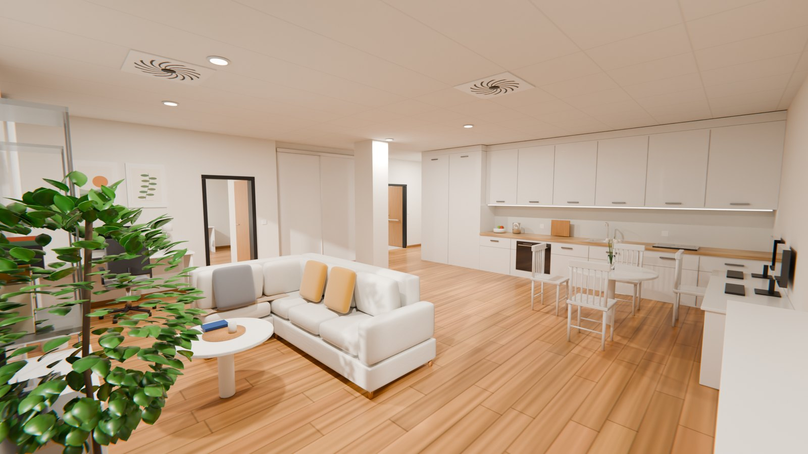

<table>
<tr>
<td>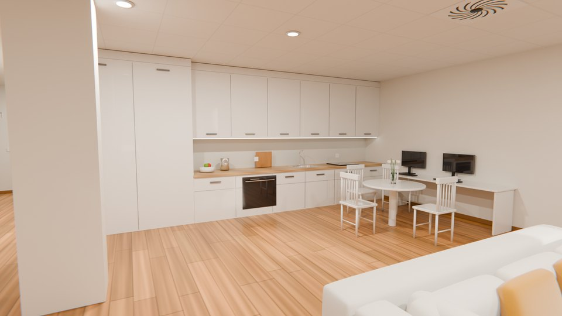</td>
<td>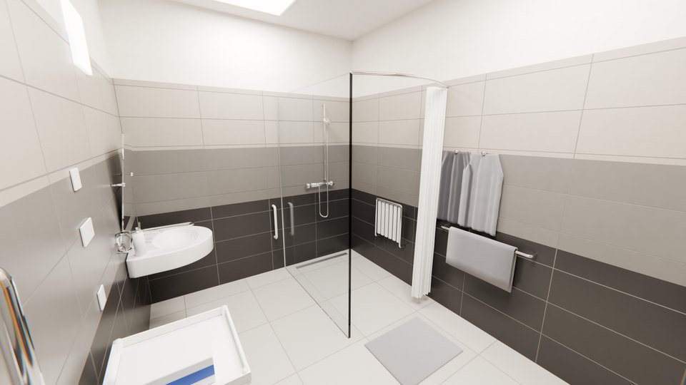</td>
<td>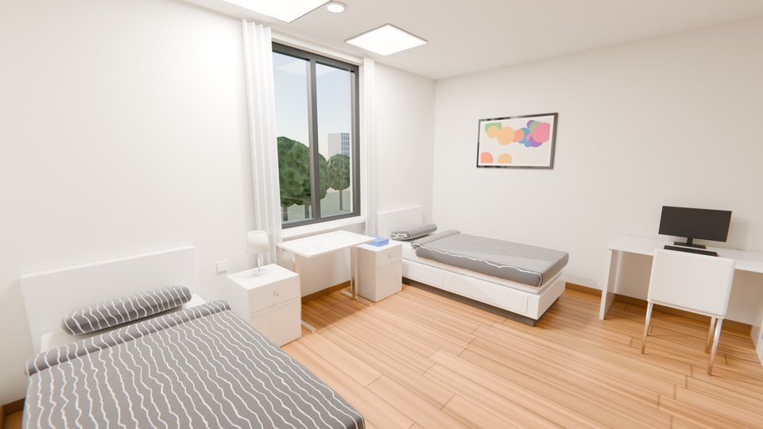</td>
</tr>
<tr>
<td>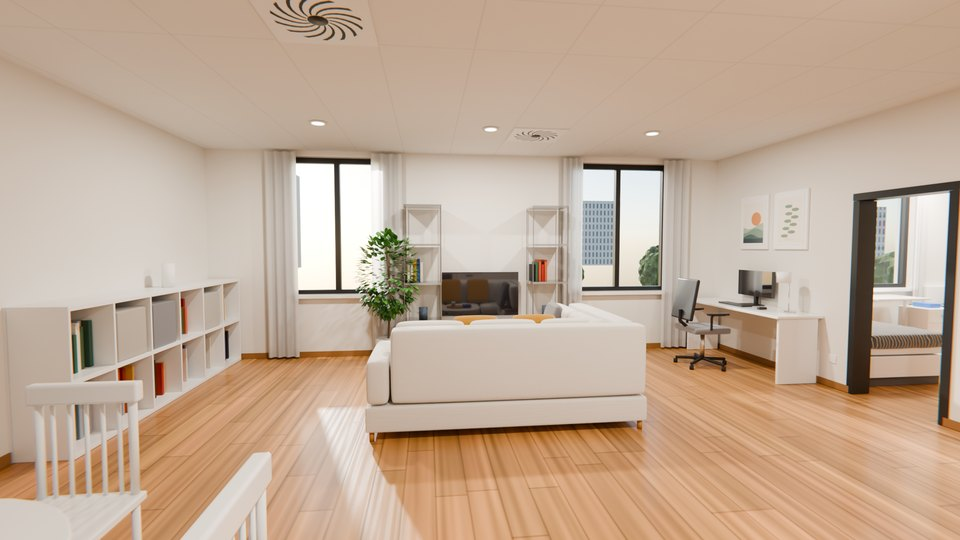</td>
<td>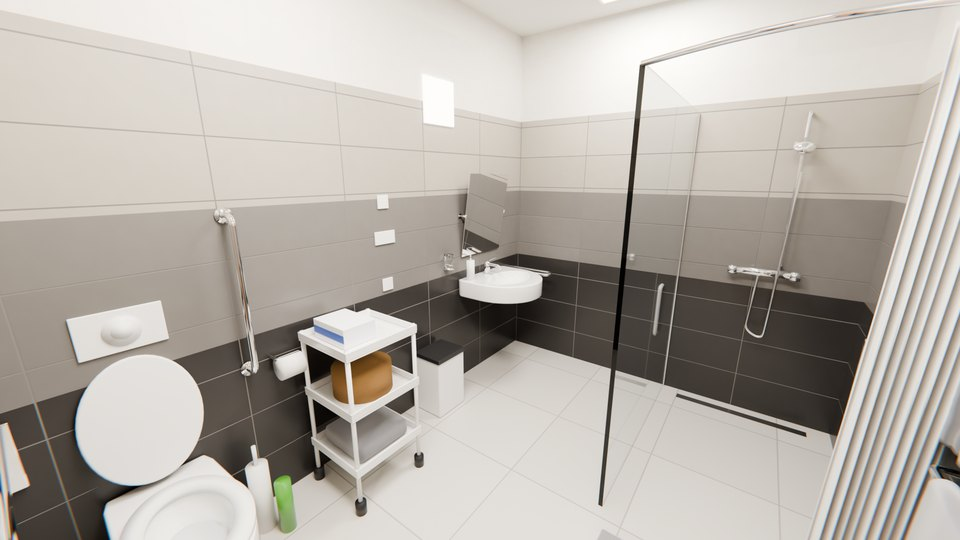</td>
<td>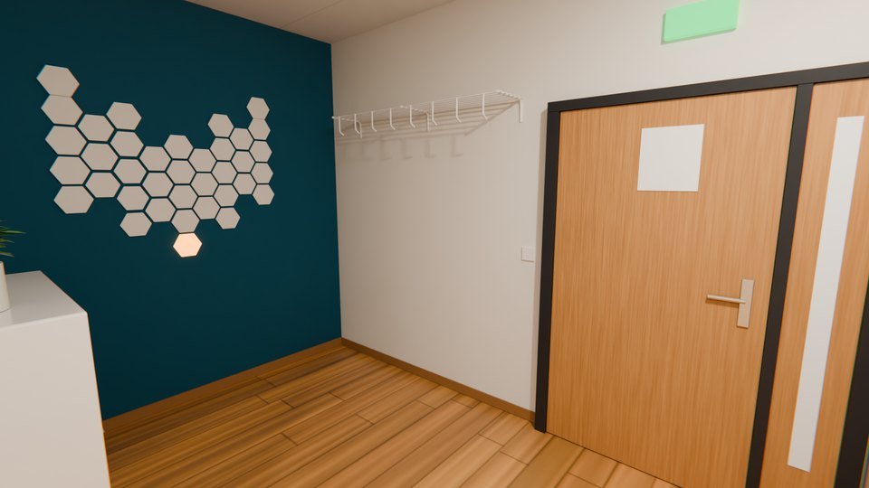</td>
</tr>
<tr>
<td>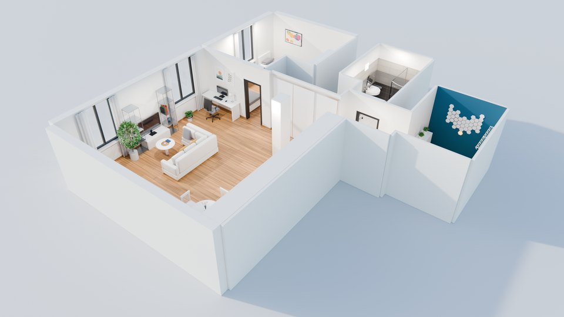</td>
<td>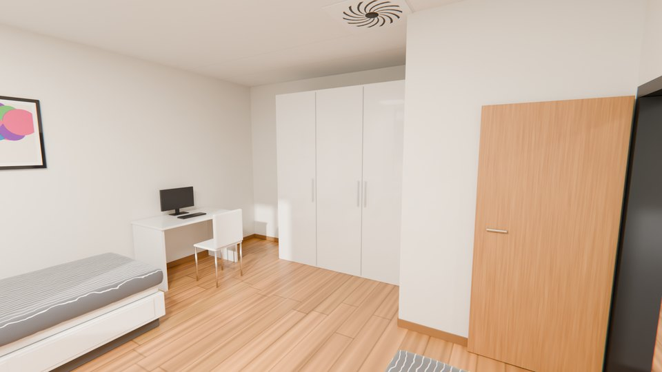</td>
<td>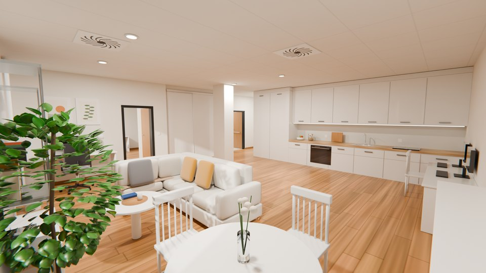</td>
</tr>
</table>

**Visualize FBX:** a Captury recording played back inside the model, in the viewer's FBX tab.

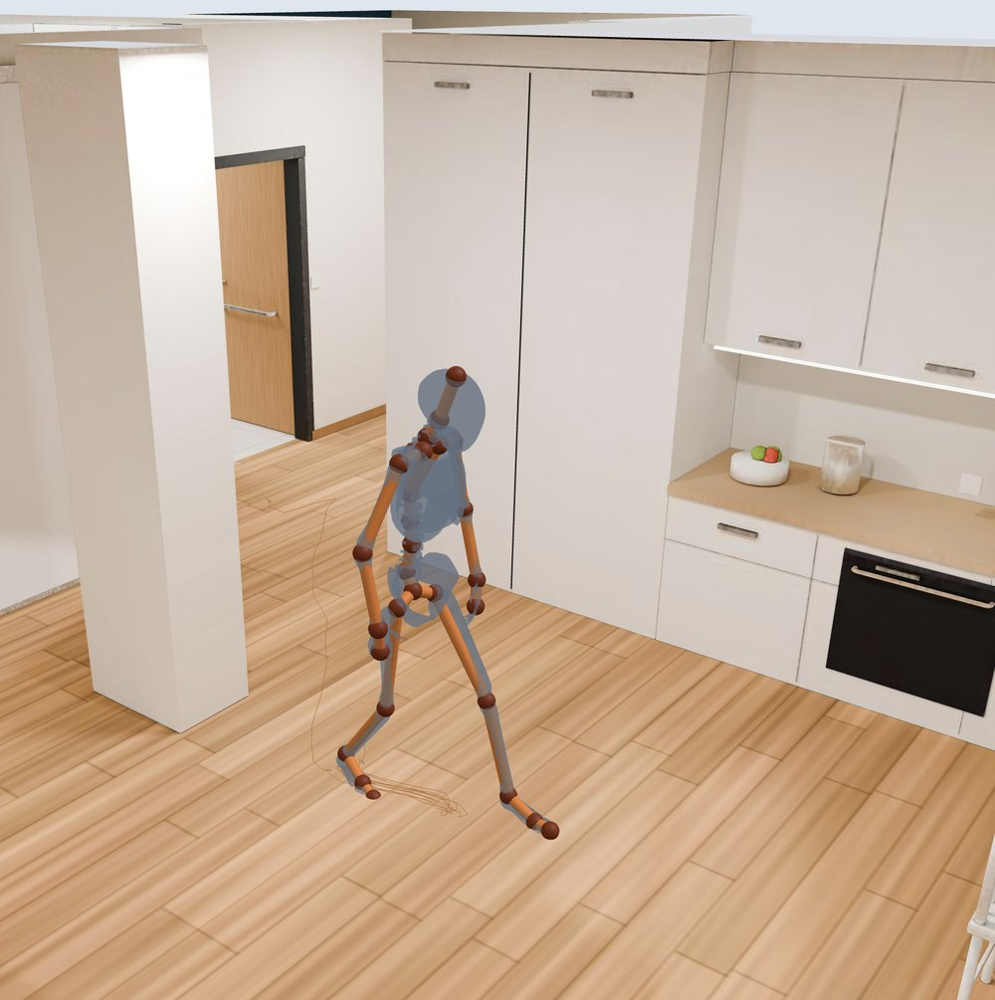

---

## Contents

- [Quick start](#quick-start)
- [What is in the repository](#what-is-in-the-repository)
- [Model, splat or renders – which one to use](#model-splat-or-renders--which-one-to-use)
- [Coordinate frames and moving data](#coordinate-frames-and-moving-data)
- [The viewer](#the-viewer)
- [Blender scenes](#blender-scenes)
- [Accuracy and known issues](#accuracy-and-known-issues)
- [Reproducing the outputs](#reproducing-the-outputs)
- [Using the model or its outputs in your work](#using-the-model-or-its-outputs-in-your-work)
- [License](#license)
- [Version history](#version-history)

---

## Quick start

**Viewer:**

```bash
python3 -m http.server 8766 --directory viewer
```

Then open <http://localhost:8766/>. Any static web server works. The viewer loads three.js and gaussian-splats-3d from a CDN, so it needs an internet connection.

**Blender with a mocap recording:**

1. Open `blender/flat_photoreal_captury.blend` (for FBX exported by Captury) or `blender/flat_photoreal_wishcap.blend` (for FBX from the WishCap panel).
2. Run *File › Import › FBX* with the default settings. The take lands in the right place in the flat.

**Any other tool:** import `model/flat_baked.glb`. It is in metres, Y up, with the floor at y = 0. To move your data into it, see [Coordinate frames and moving data](#coordinate-frames-and-moving-data).

---

## What is in the repository

| Path | Content |
|---|---|
| `model/flat_baked*.glb` | The model with light baked into the textures (unlit, looks like the renders in any glTF viewer). 12 variants, see below. |
| `blender/flat_photoreal*.blend` | Full Cycles scenes: materials, lights, render cameras. Hidden collections `wishcap_cameras` and `mat_2x2m`. |
| `renders/` | Final renders, 2560 × 1440, Cycles, 288 samples (15 views), the floor plan in metres (`floor_plan_metres.png`) and a registration check (`check_captury_c3d_in_flat.png`). |
| `viewer/` | Browser viewer: Model, Hybrid splat, Gaussian splat, Visualize FBX, Renders. |
| `transforms/frames.json` | All 4 × 4 matrices between the model frame, the mocap frames and the splat frame (Python, Blender, three.js). |
| `viewer/rig.json` | The 30 rig cameras of both calibrations, the rig → model matrices, the mat and the room polygons. Cameras are shown at `p` (snapped to the model walls) and keep their calibrated position in `p_calib`. |
| `TODO.md` | Open work, mainly **more precise alignment of the cameras with the flat**. |
| `scripts/` | The pipeline that produced everything (Python + Blender), as used. |
| `splat/` | Hybrid splats and the original Gaussian splat (PLY, INRIA 3DGS format). **Not in git** (see below). Only `hybrid_splat_preview.png` is committed. |
| `docs/images/` | Images for this README. |

**Variants.** File-name suffixes combine:

| Suffix | Meaning |
|---|---|
| *(none)* | Model frame: metres, axes of the flat. Use this when the model is used on its own. |
| `_no_ceiling` | Without the ceiling, for top views. |
| `_table2` | The dining table and its 3 chairs moved to the window by the shelf, leaving a large free area in front of the kitchen. |
| `_wishcap` | Placed in the frame of the WishCap panel takes (calibration `camera-2026-02.calib`). |
| `_captury` | Placed where Blender puts an FBX exported by Captury (calibration `shot_003`). |

**Large files that are not in git.** GitHub refuses files over 100 MB. Ask the maintainers for these, or get them from the release assets:

- **`splat/*.ply`**: hybrid splats of 330–355 MB (~5.2 M gaussians each, SH0) and the original splat `gaussian_splat_original.ply` (121 MB).
  - The web versions (`viewer/*.splat`) are in git.
  - `hybrid_splat.ply`, `_no_ceiling`, `_table2` are in metres, in the splat frame (see below), so they overlay the original splat directly.
  - `_wishcap` / `_captury` hybrids are in the rig frame (metres, Y up).
  - `gaussian_splat_original.ply` is in the splat frame in splat units (1 unit = 1.1711 m).
**Recordings.** The repository contains **one demo recording**, `viewer/fbx/demo_RK0F.fbx`: a single Captury take, included only to show the viewer. The dataset it comes from is **not** part of this repository and is distributed separately under its own terms. All other FBX files in `viewer/fbx/` are ignored by git, so recordings are not committed by accident.

---

## Model, splat or renders – which one to use

| Use | Best choice | Why |
|---|---|---|
| Measuring distances, clearances, wheelchair turning circles, furniture layout | **Model** (GLB / Blender) | Clean planar walls, real metres (doors 0.83 / 0.87 × 1.94 m, ceiling 2.70 m). Every object is a separate mesh. |
| Overlaying mocap, checking floor contact, collisions, occlusion, ray casting | **Model** in the `_wishcap` / `_captury` frame | Watertight surfaces you can hit-test. Registered to the rig to a few cm. |
| Synthetic data: rendering the subject from the rig cameras, depth / segmentation, simulation | **Blender scene** + `wishcap_cameras` | Exact camera poses and lens from the calibration. Every surface has a material. |
| Figures for papers and presentations | **Renders** (`renders/`) or a new Cycles render from the `.blend` | Photoreal, consistent lighting, any resolution. |
| Real-time walkthroughs, web, VR | **Baked GLB** (`model/`, viewer *Model* tab) | ~12 MB, unlit, looks like the renders with no lights. |
| Showing the *actual* state of the flat as captured (real textures, small objects, clutter) | **Gaussian splat** (original) | It is the measurement itself. But geometry is soft, the textureless ceiling is noisy, there are floaters, and the table is only in position 1. |
| Splat-based pipelines (novel views, splat editors, NeRF / 3DGS tooling) that need clean, complete geometry | **Hybrid splat** | Gaussians sampled from the model: sharp walls, no holes, no floaters, both table positions, rig-frame versions available. |
| Comparing the reconstruction with the model, or checking what was really there | Original vs hybrid splat side by side | Same frame, switch in the viewer header. |

Rules of thumb:

- If you need **numbers** (positions, distances, contacts), use the model.
- If you need **what the camera actually saw**, use the original splat.
- If you need **a splat that behaves like the model**, use the hybrid.
- If you need **a picture**, use a render.

<table>
<tr>
<th>Original Gaussian splat (as captured)</th>
<th>Hybrid splat (sampled from the model)</th>
</tr>
<tr>
<td>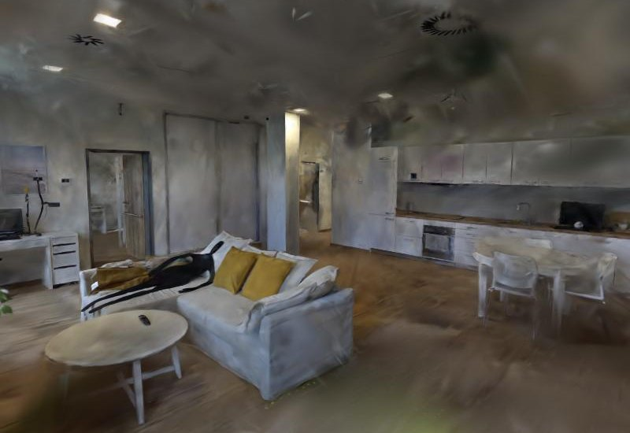</td>
<td>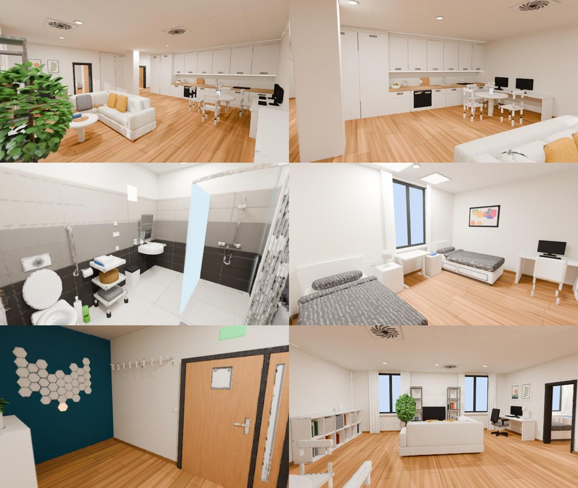</td>
</tr>
</table>

---

## Coordinate frames and moving data

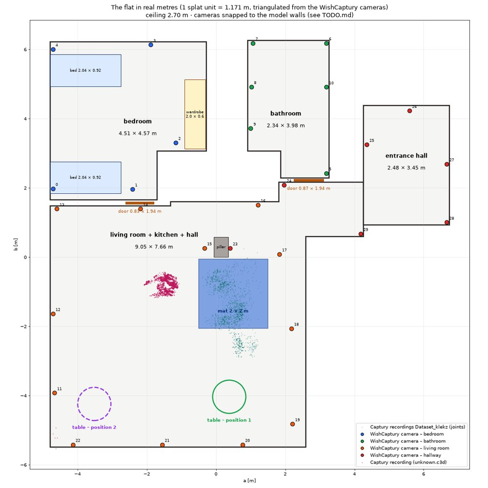

*Floor plan in metres (model frame, a / b axes). It shows the 30 WishCaptury cameras, both table positions, the 2 × 2 m mat by the pillar and the Captury recordings.*

### The frames

| Frame | Axes, units | Used by |
|---|---|---|
| **Model frame**, glTF axes | x = a (west → east), y = height, z = −b (b runs south → north). Metres, floor y = 0, ceiling 2.70 m. | `model/flat_baked.glb`, viewer tabs Model and Visualize FBX |
| **Model frame**, Blender axes | x = a, y = b, z = height | `flat_photoreal.blend`, any glTF imported into Blender |
| **WishCap rig, 2026-02** | Calibration `camera-2026-02.calib`. Metres (mm in FBX/C3D), Y up. The floor is at y ≈ 0.104 m. | Takes from the WishCap operator panel |
| **Captury rig, shot_003** | Calibration of the Captury exports (e.g. Dataset_klekz). mm in FBX/C3D, Y up, floor y ≈ 0. | C3D / FBX exported by Captury |
| **Splat frame** | The frame of the original reconstruction: +Y **down** (COLMAP convention), turned 10.75° about the vertical against the walls. Metres or splat units. | Original and hybrid splats, viewer splat tabs |

**Import conventions.**

- **Blender** imports a Y-up glTF and a WishCap FBX as (x, y, z) → (x, −z, y). It imports a **Captury FBX** as (x, y, z) → (−x, z, y), which is turned 180° about the vertical. That is why `_captury` files differ from a plain glTF of the same frame.
- **three.js** (`FBXLoader`) loads both Captury and WishCap FBX unchanged, in rig millimetres.

### Option A: use the pre-registered files

Import the take with default settings into `flat_photoreal_wishcap.blend` / `_captury.blend`, or next to `flat_baked_wishcap.glb` / `_captury.glb`. No maths needed.

### Option B: use the model alone and move your data into it

Every matrix is in `transforms/frames.json`. They are 4 × 4, row-major, act on column vectors `[x, y, z, 1]`, and use metres.

**Points in Python**, e.g. C3D markers or joint positions:

```python
import json, numpy as np
F = json.load(open("transforms/frames.json"))
M = np.array(F["rig_to_model"]["captury_shot003"]["matrix"])    # or "wishcap_2026_02"
P_rig = markers_mm / 1000.0                                     # (N, 3), rig frame, Y up, metres
P = (np.c_[P_rig, np.ones(len(P_rig))] @ M.T)[:, :3]            # model frame: x = a, y = height, z = -b
P_blender = P[:, [0, 2, 1]] * [1, -1, 1]                        # (a, b, height) if you work in Blender axes
```

**Splats** use `splat_to_model` (`metres` for the hybrid and `viewer/*.splat`, `units` for `gaussian_splat_original.ply`). It moves positions; to move whole gaussians, also rotate their orientations, as `hybrid_splat.py --rig` does.

**An imported take in Blender:** open `flat_photoreal.blend` (or import `flat_baked.glb`), import the FBX, select its top-level objects and run:

```python
import bpy, json
from mathutils import Matrix
F = json.load(open("/path/to/health-lab-model/transforms/frames.json"))
T = Matrix(F["blender"]["captury_fbx"]["frame_to_model"])   # Captury FBX; "wishcap" for WishCap FBX or a Y-up glTF,
for o in bpy.context.selected_objects:                       # "captury_gltf" for Y-up data in the Captury frame
    if o.parent is None:
        o.matrix_world = T @ o.matrix_world
```

**three.js:** put the loaded FBX in a group and give the group the matrix. `viewer/fbx.html` does exactly this and also detects the calibration from the cameras stored in a Captury FBX.

```js
const M = new THREE.Matrix4().set(...frames.rig_to_model.captury_shot003.matrix.flat())
                             .multiply(new THREE.Matrix4().makeScale(0.001, 0.001, 0.001));   // FBX is in mm
group.matrixAutoUpdate = false; group.matrix.copy(M); group.add(fbx);
```

### Option C: move the model into your frame

- **Use the inverse matrices.** In Python use `rig_to_model[...]["inverse"]`; in Blender use `blender[...]["model_to_frame"]` on the root of the model.
- **Re-export a GLB** in another frame:

  ```bash
  Blender -b -P scripts/bl_reframe.py -- model/flat_baked.glb out.glb panel|captury|captury_fbx
  ```

- **Own origin.** For a different origin (e.g. the centre of the mat, or a corner), compose a translation after `rig_to_model`. For example, the mat centre in the model frame is x = 0.492, z = 1.047 (glTF axes).

### Pitfalls

- **Units.** FBX and C3D from both systems are in **millimetres**. The model, `frames.json` and `rig.json` are in **metres**.
- **Opening rest pose.** Captury takes start with one or two frames of the rest pose at the origin. Skip them; the viewer does this automatically.
- **Two calibrations.** The two calibrations are different frames. A take recorded with one and mapped with the other ends up metres away or outside the flat. If the cameras are stored in the FBX, let the viewer pick the frame.
- **Matching across systems.** The transform between the two mocap frames is fitted on the camera centres (median 5 cm). Use the frame the take was recorded in rather than chaining through the other one.

---

## The viewer

| Tab | What it does |
|---|---|
| **Model** | Walk through the baked model. Drag = look around, W A S D / arrows = walk, Q / E = down / up. Preset viewpoints, ceiling on/off, table position 1/2. Checkboxes **Cameras** (the 30 rig cameras with view frusta and numbers, coloured by room, snapped to the model walls – see TODO.md) and **Mat 2 × 2 m** (a blue 10 cm mat by the pillar, where the Dataset_klekz takes were recorded). |
| **Hybrid splat** | The hybrid splat, with or without ceiling, table position 1/2. |
| **Gaussian splat** | The original Gaussian splat as captured, in the same frame and with the same viewpoints. |
| **Visualize FBX** | Plays FBX recordings inside the flat, see below. |
| **Renders** | All final renders, the floor plan and the registration check. Click an image for full size. |

**URL parameters** (shareable links):

| Parameter | Effect |
|---|---|
| `?table=2` | Table in position 2. |
| `?cameras=1` | Cameras checkbox on. |
| `?mat=1` | Mat checkbox on. |
| `?ceiling=1` | Ceiling on (Visualize FBX). |
| `?p=x,y,z&t=x,y,z` | Model: look from point `p` at point `t`, in metres, glTF axes. |
| `?f=<file>.fbx` | Visualize FBX: the recording to load. |
| `?s=original` | Splat page: the Gaussian splat. |

### Visualize FBX

**Controls:**

- **Play / pause:** the ▶︎ / ❚❚ button or the space bar.
- **Scrub:** the time slider.
- **Step:** ◀︎| |▶︎ or ← → move by one frame, with Shift by one second.
- **Speed:** 0.1× – 4×.

**Panels and options:**

- The info panel shows time and frame, the room, the hips position and **the lowest joint relative to the floor**, a quick check that a take sits right.
- Options:
  - follow the subject;
  - body surface (the Captury mesh);
  - hips trail on the floor;
  - ceiling, cameras, mat, table position;
  - top / oblique / side / front views.

**Registration:**

- **Captury FBX** files contain the 12 rig cameras, named by MAC address. The viewer matches them against both calibrations over all axis permutations, signs and units, and keeps the best fit. The demo take (and every take of its dataset that we tested) comes out at **12 cameras, 0.0 mm, calibration shot_003**.
- **WishCap FBX** files have no cameras. They are read as rig (x, y, z) in mm, and you pick the frame in the menu next to the file button.

**Your own recordings:**

- **One-off:** "Open your own FBX…" or drag a file into the window. The file appears in the menu under *Your files* and stays there until you reload the page, so you can switch between files.
- **Permanent:** copy the FBX to `viewer/fbx/` and add a line to `viewer/fbx/index.json`. The `frame` field is only needed for FBX without cameras.

  ```json
  {"file": "my_take.fbx", "name": "My take", "group": "My recordings", "frame": "2026-02"}
  ```

---

## Blender scenes

| File | Frame |
|---|---|
| `flat_photoreal.blend`, `flat_photoreal_table2.blend` | Model frame. |
| `flat_photoreal_wishcap.blend`, `flat_photoreal_table2_wishcap.blend` | WishCap 2026-02 frame. Everything hangs under the empty `flat_in_mocap_frame`, so the registration is one visible transform. |
| `flat_photoreal_captury.blend`, `flat_photoreal_table2_captury.blend` | Where a Captury FBX lands. |

**Collections** (hidden by default; switch the eye icon on):

- `wishcap_cameras`: 30 real Blender cameras with orientation and focal length from `camera-2026-02.calib`, placed 8 cm in front of the model walls. The calibrated centre is in the custom property `calibrated_position`; see [TODO.md](TODO.md). Select one and press Ctrl + Numpad 0 to look through it.
- `mat_2x2m`: the blue 2 × 2 × 0.10 m mat. It is also excluded from rendering by default.

`render_camera` is the camera used for the final renders. Cycles at 288 samples takes about 4 minutes per 2560 × 1440 view on an Apple-silicon Mac.

---

## Accuracy and known issues

**Scale:** 1 unit of the original splat = **1.1711 m**. This was measured by triangulating 547 points from the calibrated rig cameras and aligning them to the splat (ICP, median residual 3.2 cm, stable on random halves). Doors come out at 0.83 / 0.87 × 1.94 m, the ceiling at 2.70 m and the beds at 2.04 × 0.92 m.

**Registration checks:**

| Check | Result |
|---|---|
| Captury C3D | The lowest marker is 0.4 cm above the model floor. |
| 20 Captury FBX takes | Lowest joint −1.8 to +1.6 cm from the floor. |
| WishCap `square002_rig.fbx` (shot_003 frame) | ±3 cm, the whole take inside the living room. |

**Known issues:**

1. A WishCap panel take from 2026-09-12, mapped with `camera-2026-02.calib`, sits in the bedroom but 10–22 cm below the floor. The take or the panel probably used a different calibration file. Check the md5 of the calibration on the capture host.
2. **Cameras vs. walls.** A few model walls and the pillar are 15–30 cm off: the living room south wall, the bathroom east wall, possibly the entrance hall south wall, and the pillar. As a result, some calibrated cameras came out behind a wall. For now the cameras are shown snapped in front of the model walls. Cameras 15 and 23 are placed next to the pillar as in a photo of it. The real fix (moving those walls, release 1.0.9) and all the evidence are in [TODO.md](TODO.md) under *More precise alignment of the cameras with the flat*. Mocap registration is not affected.
3. The shot_003 ↔ 2026-02 transform carries a 1.1° tilt, because it is fitted on camera centres only. It is exact in the living room and may be off by a few cm far from it.
4. Small objects (decoration, cables, clutter) are modelled only where they matter for the look. The original splat shows the real state.

---

## Reproducing the outputs

`scripts/` contains the pipeline **as it was used**. Paths inside are absolute to the original workspace and need adjusting. You need Python 3 with `scripts/requirements.txt` and Blender 4.3. The scripts need the original splat (`splat/gaussian_splat_original.ply`) and, for the registration, the rig calibration and frames.

**Model, renders and splats:**

1. `build_clean.py`: clean geometry from the splat (walls, floors, windows, doors, built-ins), plus `lights.json` (rooms and ceiling lights). It uses `walls2.py`, `ortho.py` and `splatio.py`. `hexes.json` holds the hall logo.
2. `bl_detail.py [stul2]`: furniture and details in Blender. `stul2` gives table position 2. It ends with `zfix.py`, which removes coplanar faces (z-fighting).
3. `bl_render.py final|quick|stul2|bake`: Cycles renders. `bl_save.py` saves the `.blend` files.
4. `bl_bake.py`: light baking into the GLB (diffuse light × albedo + glossy + emission, OIDN denoise, KHR_materials_unlit).
5. `hybrid_splat.py --hires [--rig] [--no-ceiling]`: the hybrid splat. `to_splat.py` (with `splatio.py`) converts PLY to the web `.splat`.

**Registration:**

| Script | What it does |
|---|---|
| `rig_tri.py`, `rig_icp.py` | Triangulation and ICP → `rig_icp.json`. |
| `rig_xf.py` | The model ↔ rig matrices. |
| `make_frames.py` | Writes `transforms/frames.json`. |
| `cams_json.py` | Writes `viewer/rig.json`. |
| `bl_reframe.py`, `bl_reframe_blend.py` | Move a GLB / `.blend` into a frame. |
| `bl_extras.py` | Adds the camera and mat collections. |
| `bl_english.py` | English names in the `.blend` files. |
| `bl_fbx_on_model.py`, `bl_fbx_probe.py`, `bl_fbx_cams.py`, `bl_take_extent.py`, `bl_c3d_check.py`, `plan_m.py` | Checks and the floor plan. |

---

## Using the model or its outputs in your work

The Health.Lab Model is free for **non-commercial** research, teaching and personal use under the [license](LICENSE.md). In return, we ask for credit in proportion to how much your work relies on it:

| How much your work uses it | What is expected |
|---|---|
| Any use: viewing, internal work, a figure or a short clip | Keep the credit line with shared images and videos and **mention** the Health.Lab Model, e.g. in the acknowledgements or a figure caption. |
| A publication, thesis, poster or talk that uses the model, data or visualizations | **Cite** the Health.Lab Model (see below) and mention it in the text. |
| Visualizations are a **substantial** part of the results or figures | **Contact us before submission**. Participation in the paper (e.g. co-authorship of the people who built the model) is expected, by agreement and according to the extent of use. |
| The paper is **built mainly on the visualizations** | It should be a **collaboration** with Health.Lab, with co-authorship agreed in advance. |
| Any **commercial** use (products, paid services, contract work, advertising, sale of the model or of images) | Not allowed without a separate written agreement. |

**Practical steps:**

1. **Credit line** for images and videos made with the model: *"Visualization: Health.Lab Model v1.0.8 Beta, Health.Lab."*
2. **Agree in writing.** If you are unsure which row applies, write to us before you submit. A short e-mail exchange is enough, and a written agreement takes precedence over the defaults above.
3. **Recordings of people.** Motion-capture recordings are personal data. The license covers the model, not your recordings. Use only recordings you have the participants' consent to use. The demo recording may only be used to try the viewer (see LICENSE.md, section 6).
4. **Third parties.** Keep the license file with any copy of the model or its derivatives, and do not pass the material on under different terms.

**How to cite:** GitHub shows *"Cite this repository"* from `CITATION.cff`. In BibTeX:

```bibtex
@misc{healthlab_model_2026,
  title   = {Health.Lab Model: a photoreal, motion-capture-registered 3D model of a barrier-free apartment},
  author  = {{Health.Lab}},
  year    = {2026},
  version = {1.0.8 Beta},
  note    = {Non-commercial use; attribution and collaboration terms in LICENSE.md}
}
```

**Contact:** Health.Lab. *Maintainers: add the contact e-mail here.*

---

## License

Released under the **Health.Lab Model License – Non-Commercial, Attribution and Collaboration, v1.0** (see [LICENSE.md](LICENSE.md)). In short:

- non-commercial use only;
- credit required;
- academic use is expected to be acknowledged or cited, with participation in the paper according to the extent of use;
- papers built mainly on the visualizations should be a collaboration.

It is not an open-source license. Third-party libraries used by the viewer (three.js, @mkkellogg/gaussian-splats-3d, both MIT) keep their own licenses.

---

## Version history

| Version | Content |
|---|---|
| 1.0.1 | Light baked into the GLB, wider TV, door frames fixed, dresser moved opposite the door. |
| 1.0.2 | Larger bedroom window, realism pass, bathroom and sink position. 10 review rounds → first final renders and the hybrid splat. |
| 1.0.3 – 1.0.4 | Bathroom / WC entrance, bedroom fixes, chair no longer through the table, wardrobe from the corner, wider PC desk, matching bedding, wider shower. |
| 1.0.5 | Flickering black cabinet corners fixed (z-fighting), bedroom wardrobe with three doors moved toward the door. |
| 1.0.6 | Dimensions checked against the rig cameras (with a scale that was later corrected). |
| 1.0.7 | True scale 1.1711 m/unit from triangulation. Model registered to the WishCap and Captury frames. Symmetric hall logo, beds clear of the door, high-resolution hybrid splat, table position 2, larger bedroom with a freestanding wardrobe. |
| **1.0.8 Beta** | **Health.Lab Model.** Visualize FBX viewer (play, scrub, automatic registration from the cameras in the FBX). Camera and mat toggles. Gaussian splat in the menu. `_captury` files corrected to the Captury FBX axis convention. English release with `frames.json`, license and citation. |

<sub>ver 1.0.8 Beta</sub>
